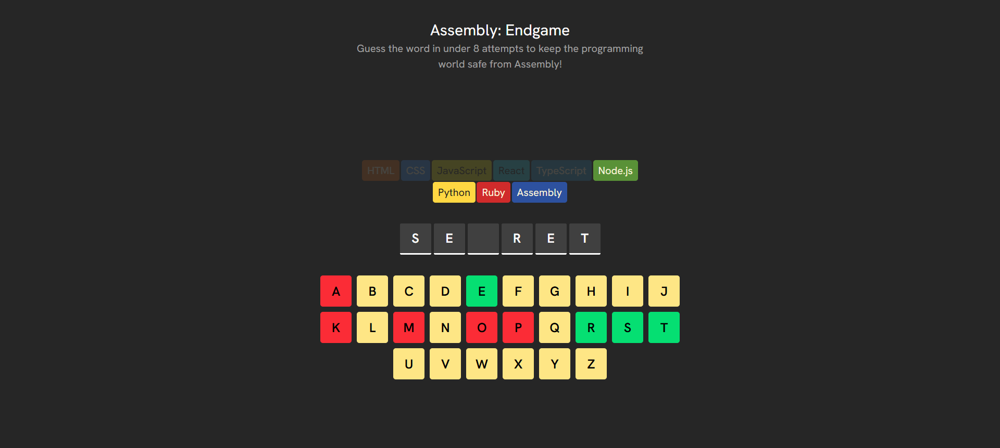

# 💻 Assembly: Endgame

A word-guessing game built with React, TypeScript, and Tailwind CSS. Save the programming world from an Assembly takeover by guessing the hidden word before high-level languages disappear.



## 🔗 Links

- **Live Demo:** [View Live Site](https://hangman-assembly-endgame.vercel.app/)
- **Repository:** [View Source Code](https://github.com/iviktorry/hangman-assembly-endgame)

---

## Tech Stack & Highlights

- **Core:** TypeScript, React 19, Vite, Tailwind CSS
- **UX & Effects:** `react-confetti`, Lucide React
- **JSX to TSX Migration:** Full codebase refactor with strict typing across React hooks, explicit props interfaces, and utility handlers.
- **Minimal State Architecture:** Computed game states (`isGameWon`, `isGameLost`, `wrongGuessCounter`) derived purely on the fly without redundant `useState` triggers.
- **Performance & A11y:** Lazy state initialization (`useState(() => getRandomWord())`) to optimize re-renders, and dynamic `sr-only` screen-reader aria announcements.

---

## 🎮 Features & Rules

- **Language Elimination:** Each incorrect guess removes a high-level language until only Assembly remains.
- **Dynamic Farewells:** Generates contextual farewell messages as languages go extinct.
- **Accessible Controls:** Keyboard and click-based input with dynamic `disabled` and `aria-pressed` states.
- **Victory Effects:** Celebratory fullscreen confetti particles upon winning.

---

## Getting Started

```bash
# Clone the repository
git clone [https://github.com/iviktorry/hangman-assembly-endgame.git](https://github.com/iviktorry/hangman-assembly-endgame.git)
cd hangman-assembly-endgame

# Install dependencies and start dev server
npm install
npm run dev
```

## 👩‍💻 Developer Contacts & Socials

[](https://github.com/iviktorry)
[](https://www.frontendmentor.io/profile/iviktorry)
[](https://t.me/wsxxdfv)
[](https://linkedin.com/in/victoria-pratkina-b23834388)
